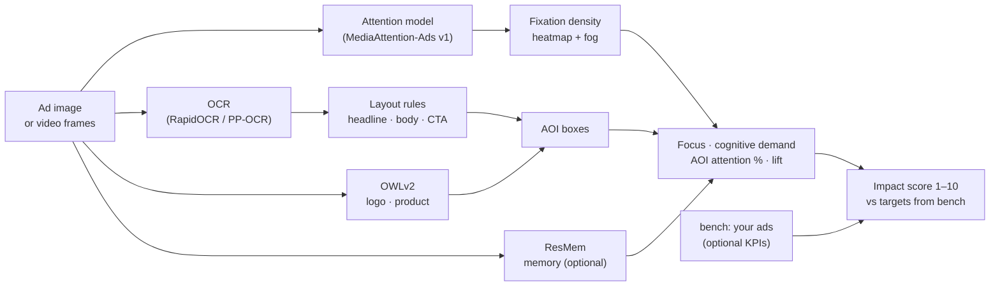
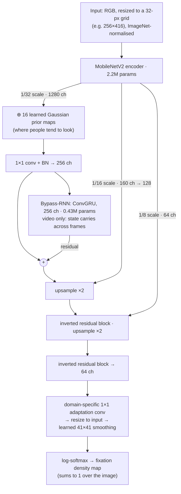

# MediaAttention

[](https://pypi.org/project/mediaattention/) [](https://doi.org/10.5281/zenodo.23540409)

**Site:** https://pranikz.github.io/MediaAttention/ · **Model on Hugging Face:** [MediaAttention-Ads v1](https://huggingface.co/pranikz/MediaAttention-Ads) · **Research report (PDF):** [docs/research/MediaAttention-report.pdf](docs/research/MediaAttention-report.pdf)

Open-source predicted attention for ads and media. Give it an image or video creative and it predicts where people will look, then scores it:

- **Attention heatmap and fog map**: where the eye lands in the first seconds
- **Focus** (0–100): attention on a few elements (high) vs. scattered everywhere (low)
- **Cognitive Demand** (0–100): visual complexity, measured as local Shannon entropy
- **Memory** (0–100, optional): predicted share of viewers who would recognise the creative after a brief exposure
- **AOI attention**: % of attention on brand, product, headline and CTA, plus *lift* (attention share ÷ area share)
- **Impact Score** (1–10): each metric is scored against a recommended range, then averaged

It's an open alternative to proprietary "neuro-prediction" tools. The methods are documented and the numbers are reproducible.

**New in 0.2.1: MediaAttention-Ads v1**, our own attention model, fine-tuned on eye tracking of posters, ads and interfaces. On held-out posters it reaches **CC 0.752** with human attention, vs 0.496 for the best other open model. That is a **+52% gain** with non-overlapping 95% confidence intervals, from a 3.7M-parameter network that runs in 0.04 s per image. See [Benchmark](#benchmark).

## Install

```bash
pip install "mediaattention[all]"   # MediaAttention-Ads model, AOI detection, video, web UI (recommended)
pip install mediaattention          # core only: spectral-residual fallback, no ML dependencies
pip install "mediaattention[memory]"   # + memory score (ResMem). NON-COMMERCIAL license, see Licenses
```

Or from source: `git clone https://github.com/pranikz/MediaAttention && pip install -e ".[all]"`. The extras can also be installed one at a time: `unisal`, `aoi`, `video`, `ui`, `memory`.

DeepGaze IIE (optional, `--model deepgaze`) isn't on PyPI. Install it from source:

```bash
pip install torch torchvision einops clip-anytorch "deepgaze_pytorch @ git+https://github.com/matthias-k/DeepGaze"
```

When ResMem is installed, `memory` is added to every report automatically. Videos also get `memory_start` / `memory_end`.

## Use

### Web UI

```bash
mediaattention ui        # opens http://localhost:7860
```

Drop in an image or video (or click one of the built-in examples), optionally name the product, and hit **Analyse**. You get:

- the Impact Score with a verdict
- every metric with its 1–10 score and target range
- the AOI table
- heatmap, fog map and AOI overlay for images; heatmap video and a Focus/Cognitive Demand/Memory timeline for videos
- `scores.json` to download

The **Calibrate** tab does `bench` in the browser: upload a batch of ads from one category (select many files) and it builds the target ranges, shows them, and loads them into the Analyse tab. You can also download that `benchmarks.json`, or upload one under *Options* in the Analyse tab. Everything runs on your machine. `--share` creates a temporary public link if you want to show someone.

### Command line

```bash
mediaattention ad.png --aoi auto --product "a running shoe" --out report/
```

This writes `report/heat.png`, `report/fog.png`, `report/aois.png` (heatmap with each AOI boxed and its attention %) and `report/scores.json`:

```json
{
  "model": "ads",
  "metrics": {"focus": 64.2, "cognitive_demand": 38.5, "brand_attention": 12.1},
  "aois": [{"label": "brand", "box": [0.05, 0.04, 0.3, 0.14], "attention_pct": 12.1, "area_pct": 3.5, "lift": 3.46}],
  "impact_score": 10.0,
  "impact_parts": {"focus": 10.0, "cognitive_demand": 10.0, "brand_attention": 10.0}
}
```

The example values are illustrative.

### Calibrate the Impact Score on your own ads

The default recommended ranges are placeholders. Build real ones from a folder of creatives, ideally one folder per industry or use case with 30+ assets each:

```bash
mediaattention bench ads/fmcg-social/ --aoi auto --out bench/
mediaattention new_ad.png --aoi auto --benchmarks bench/benchmarks.json
```

`bench` scores every image and video in the folder and writes `assets.jsonl` (one line of metrics per asset) and `benchmarks.json`:

- **Higher-is-better metrics** (Focus, attention on brand, product, headline and CTA): the recommended range is the top 20%.
- **Cognitive Demand:** the middle 50%, because moderate complexity works best.
- **Body-text attention:** excluded, because it doesn't predict results.

**Have campaign results?** Pass them in and the targets come from your best-*performing* ads instead of your best-*scoring* ones:

```bash
mediaattention bench ads/fmcg-social/ --aoi auto --kpi results.csv --kpi-column ctr --out bench/
```

- **Format:** `results.csv` has a `file` column (the ad's filename, or its path inside the folder) plus KPI columns such as `ctr`, `recall` or `cpc`. Add `--kpi-lower-better` for costs like CPC or CPA.
- **Targets:** each metric's target becomes the middle 50% of what your top 20% of ads by that KPI scored.
- **`kpi_report.json`:** shows which metrics actually track the KPI for your ads (Spearman ρ and p-value).
- **Web UI:** the Calibrate tab takes the same CSV.
- **Size:** you need at least 25 ads with a KPI, so there are 5 winners.

### Video

```bash
mediaattention ad.mp4 --aoi auto --product "a running shoe" --fps 2 --out report/
```

This writes `report/heat.mp4` (the heatmap and AOIs on every scored frame) and `report/scores.json`. The JSON has a summary plus a per-frame `timeline`:

- Attention comes from UNISAL's **video mode**: a recurrent model fed ~6 frames per second, so attention carries over from frame to frame as in real viewing. `--per-frame` scores frames independently instead (any `--model`), averaged over the last second.
- `cuts`: hard scene cuts in seconds. Key messages placed right after a cut are easily forgotten.
- `focus_start` / `focus_end`: Focus over the first and last 2 seconds.
- Per AOI: `total_attention` (share over the whole video), `relative_attention` (share while on screen) and `availability_s` (seconds on screen).

You can also pass your own AOIs (`--aoi aois.json`, as `[{"label": "brand", "box": [x0, y0, x1, y1]}]` in 0–1 coords) and your own recommended ranges (`--benchmarks ranges.json`, as `{"focus": [60, 100]}`).

From Python:

```python
from PIL import Image
from mediaattention import score
heat, report = score(Image.open("ad.png"))  # model="ads" (MediaAttention-Ads v1) by default; "unisal", "deepgaze" or "spectral" also work
```

## Architecture

### Pipeline



Video adds cut detection (histogram jumps on every frame), optical-flow tracking of AOIs within each shot, and UNISAL's recurrent video mode.

### Attention model: MediaAttention-Ads v1 (UNISAL architecture, 3.7M parameters)



UNISAL (Droste et al., ECCV 2020) was trained jointly on image (SALICON) and video (DHF1K, Hollywood-2, UCF Sports) eye-tracking data. Its batch norm, prior maps, adaptation and smoothing are domain-specific, so one network serves both modes:
- **Images** use the SALICON branch and skip the recurrent block.
- **Video** uses the DHF1K branch, with the ConvGRU carrying attention from frame to frame.

**MediaAttention-Ads v1** keeps this network and retrains it on design eye tracking:
- **Data:** the UEyes training split (Jiang et al., CHI 2023, CC BY 4.0). It has 1,872 posters, ads, mobile and desktop UIs and webpages, with eye tracking from 62 participants; 10% is held out to pick the epoch. The UEyes test split and FiWI were never touched.
- **Loss:** KL divergence − CC against the fixation density.
- **Training:** AdamW, lr 3e-5, batch norm frozen (batch size 1), 8 epochs on an M3 Pro (~25 min). The best epoch was 5, with held-out CC going from 0.502 to 0.769.
- **Script:** [`benchmarks/finetune_unisal.py`](benchmarks/finetune_unisal.py).
- **Weights:** [huggingface.co/pranikz/MediaAttention-Ads](https://huggingface.co/pranikz/MediaAttention-Ads).

Video still uses the stock UNISAL video weights: there is no open ad-video eye-tracking set to tune them on yet.

### How it compares with other attention models

| Model | Architecture | Params | Trained on | Video | Licence | s / image (M3 Pro) | UEyes test CC | FiWI CC |
|---|---|---|---|---|---|---|---|---|
| **MediaAttention-Ads v1** (ours) | UNISAL: MobileNetV2 encoder, Gaussian priors, ConvGRU (video), decoder with skips | 3.7M | SALICON → fine-tuned on UEyes (posters, ads, UIs) | yes (recurrent) | Apache-2.0 | 0.04 | 0.735 | 0.631 |
| UNISAL (stock) | same as above | 3.7M | SALICON, DHF1K, Hollywood-2, UCF Sports | yes (recurrent) | Apache-2.0 | 0.04 | 0.467 | 0.616 |
| TranSalNet-Dense | DenseNet-161 CNN + transformer encoder + CNN decoder | 76.6M | SALICON | no | MIT | 0.10 | 0.514 | 0.608 |
| DeepGaze IIE | ensemble of 4 backbones (DenseNet-201, ResNeXt-50, EfficientNet-B5, ShapeNet-ResNet-50) + readout | 104.0M | SALICON → MIT1003 | no | no licence file | 0.67 | 0.454 | 0.649 |
| DeepGaze MSDB | CLIP RN50x64 + DINOv2 ViT-B/14 at several scales + readout, dataset-bias parameters | 451.6M | MIT1003, CAT2000, COCO-Freeview, DAEMONS, FIGRIM | no | no licence file | 2.90 | 0.452 | 0.676 |
| Neurons (commercial, for reference) | CNN encoder–decoder (ConvNeXt / ResNet-50 components), per its public tech paper | not disclosed | proprietary eye tracking (~20k participants) | separate video model | closed | – | not runnable | not runnable |

Where we win:
- **Accuracy on ads and posters.** It is first on every UEyes category (posters, mobile, desktop, web) by a wide margin, because it is the only open model trained on designed visual content.
- **Size and speed.** It is 20–120× smaller than the alternatives and 17–70× faster than DeepGaze. It runs on a laptop CPU, and a 1,000-ad batch takes under a minute on an M3 Pro.
- **Images and video in one network**, which none of the more accurate image models offers.
- **Licence.** Code and weights are Apache-2.0; the DeepGaze models have no licence file.

Where we don't:
- **Natural images and photo-heavy webpages.** DeepGaze MSDB is still ~0.05 CC ahead on FiWI (webpages), and further ahead on pictorial pages. It is 120× larger.
- **Video is not ad-tuned.**
- **One panel's behaviour.** UEyes viewers were 62 participants in Finland on a lab eye tracker, so cultural and category coverage is narrow. The [study kit](#run-your-own-study) is how to widen it.

## Run your own study

Every commercial attention tool rests on a private panel. MediaAttention ships the panel kit instead: a browser study you can send to anyone, with no server and no uploads.

1. **Describe the study.** Write a `study.json` listing the ads, optional "foil" ads for the memory test, and the words to react to ([example](docs/collect/example-study.json)).
2. **Send the link.** Share `https://pranikz.github.io/MediaAttention/collect/?study=<url of your study.json>`. The study.json and ad images must be served from somewhere the page can fetch them. Each participant:
   - calibrates webcam eye tracking by clicking 9 dots, followed by an accuracy check;
   - views each ad for 5 s while gaze is estimated;
   - answers quick Yes/No word tests ("Engaging?", "Trustworthy?") with the F and J keys, timed in milliseconds;
   - optionally does a recognition test: has this ad been seen before?

   At the end, participants download a results file and send it back to you.
3. **Import the results.**

   ```bash
   mediaattention collect results/*.json --out study/
   ```

   The command writes:
   - `fixations.csv`: a real eye-tracking dataset. Score any model on it with `MA_COLLECTED=study python benchmarks/run.py collected`.
   - `scores.csv`: per-ad **engagement, trust, avoidance and intent** (0–100) and **memory** (recognition hit rate minus false alarms). Feed it to `bench --kpi study/scores.csv` to see which predicted metrics track what your audience actually felt.
   - `quality.csv`: per-participant calibration error. Participants above 12% of the screen diagonal are excluded.

**Where the data lives.** There is no server and no database; nothing is sent anywhere automatically.

1. **During the study:** results exist only in the participant's browser tab, in memory. Webcam frames are processed on the spot and discarded. No video or image of the participant is ever stored or transmitted.
2. **At the end:** the participant clicks *Download results* and gets one file, `mediaattention-<id>.json`, in their own Downloads folder. It contains:
   - estimated gaze coordinates on each ad;
   - their Yes/No answers with reaction times;
   - calibration accuracy and screen size.

   No name, email or IP address is recorded; the ID is a random 8-character code.
3. **Back to you:** the participant decides whether to send the file back. You choose how, in `study.json`:

   | Option | Participant sees | You need |
   |---|---|---|
   | `"upload_url"` | "Upload it here" | a Dropbox or Google Drive *file request* link (they upload without an account) |
   | `"send_to"` | "Email it to you@…", subject pre-filled | an email address |
   | `"submit_endpoint"` | a **Send results** button that posts the file directly, only when clicked | an endpoint you own. [`apps-script.gs`](docs/collect/apps-script.gs) is a ready-made Google Apps Script that saves each submission to your Google Drive |

   With none set, participants are asked to send the file by hand. Either way, you run `mediaattention collect` on the files locally.

GitHub Pages only serves the static study page; nothing flows back to it. If you want automatic collection (e.g. to a Google Sheet or your own server), add it yourself and treat it as personal data under your privacy obligations.

**How it works:**
- **Gaze:** Google's MediaPipe face landmarks (Apache-2.0) supply iris position and head pose. A per-person ridge regression, fitted on the calibration clicks, maps them to the screen.
- **Fixations:** found with a standard dispersion-threshold (I-DT) algorithm.
- **Implicit scores:** Yes/No answers weighted by how fast each person answered, relative to their own pace. Answers outside 300–2,500 ms are dropped.
- **Privacy:** the camera feed never leaves the browser tab.

**Limits:** webcam tracking is coarse (expect 2–4° of error versus about 0.5° for lab trackers), so use it for heatmaps across many people, not single fixations. Add `?sim=1` to the URL to try the flow with your mouse standing in for your eyes.

## How each number is computed

| Metric | Method |
|---|---|
| Heatmap | UNISAL (Droste et al., ECCV 2020) with its SALICON weights, downloaded on first use from [pranikz/MediaAttention](https://huggingface.co/pranikz/MediaAttention). Optional: DeepGaze IIE with a Gaussian centre-bias prior. Fallback: spectral residual (Hou & Zhang 2007). |
| Focus | Share of the image needed to hold 80% of predicted attention, mapped to 0–100 (an attention-dispersion measure). |
| Cognitive Demand | Mean Shannon entropy of 16×16 blocks of the grayscale image (32 levels), normalized to 0–100. |
| Memory | ResMem (Needell & Bainbridge 2022), trained on LaMem/MemCat recognition data. It predicts the share of people who recognise an image when it repeats in a rapid stream, the same game Neurons' memory model is built on. Scores cluster high (a plain grey image gets ~81, ads ~90–98), so compare within a `bench` corpus rather than reading absolute values. Videos are scored per frame, without audio. |
| AOI detection | OCR (RapidOCR) reads every text line. A short line on a solid colour patch is the CTA, and the box grows out to the button's edges. The largest text is the headline, and the rest is body. Logo and product come from OWLv2 zero-shot detection (`--product` says what to look for). If OWLv2 is unsure about the logo, a short text line in the top or bottom band is used instead. |
| AOI attention % | Sum of heatmap mass inside the box. |
| Video | Frames are sampled at `--fps` for scoring. With UNISAL, attention comes from its recurrent video mode (DHF1K weights), fed at ~6 fps with its state carried across the whole video. With `--per-frame` or an image model, each sampled frame is scored on its own and heatmaps are averaged over the last second, so attention lingers briefly after a cut. A cut is a jump of more than 40% in the grayscale histogram between consecutive frames, with a 0.5 s minimum shot length. Auto AOIs are detected at the start of each shot, then tracked through every frame with Lucas–Kanade optical flow. Each box gets its own shift and zoom, so camera moves and moving objects are both followed. AOIs from a JSON file stay fixed for the whole video. |
| Impact Score | 10 inside the recommended range; outside, it falls linearly from 7 at the edge to 1 at the end of the scale. The final score is the mean over available metrics, and missing AOIs are skipped. |

## Benchmark

How close are the predictions to where real people look? All metrics were computed with pysaliency on an Apple M3 Pro. The method and scripts are in [`benchmarks/`](benchmarks/), and the tables below are generated with `python benchmarks/tables.py`.

### Posters and ads (UEyes test split)

UEyes (Jiang et al., CHI 2023) has eye tracking from 62 participants, 7 s free viewing, on a Gazepoint GP3. Its test split (108 images, 27 per category) was never used for training or model selection.

| Model | CC ↑ | 95% CI | NSS ↑ | KLD ↓ |
|---|---|---|---|---|
| **MediaAttention-Ads v1** (ours) | 0.752 | [0.695, 0.809] | 1.55 | 0.354 |
| TranSalNet-Dense | 0.496 | [0.440, 0.551] | 0.98 | 0.792 |
| DeepGaze IIE | 0.458 | [0.392, 0.524] | 0.90 | 0.894 |
| UNISAL (stock) | 0.454 | [0.389, 0.518] | 0.90 | 0.913 |
| DeepGaze MSDB | 0.416 | [0.351, 0.481] | 0.86 | 1.079 |
| Spectral residual | 0.285 | [0.209, 0.361] | 0.58 | 1.082 |
| Centre-bias baseline | 0.281 | [0.218, 0.344] | 0.55 | 0.949 |

(n = 27 test posters; 95% CI over images.) MediaAttention-Ads v1's interval does not overlap any other model's.

### All UEyes test categories

| Model | CC ↑ | NSS ↑ | sAUC ↑ | SIM ↑ | KLD ↓ | poster CC | mobile CC | desktop CC | web CC |
|---|---|---|---|---|---|---|---|---|---|
| **MediaAttention-Ads v1** (ours) | 0.735 | 1.53 | 0.731 | 0.680 | 0.399 | 0.752 | 0.820 | 0.692 | 0.674 |
| TranSalNet-Dense | 0.514 | 1.00 | 0.646 | 0.559 | 0.771 | 0.496 | 0.601 | 0.482 | 0.476 |
| UNISAL (stock) | 0.467 | 0.92 | 0.640 | 0.543 | 0.864 | 0.454 | 0.504 | 0.456 | 0.452 |
| DeepGaze IIE | 0.454 | 0.92 | 0.667 | 0.522 | 0.871 | 0.458 | 0.460 | 0.453 | 0.445 |
| DeepGaze MSDB | 0.452 | 0.94 | 0.690 | 0.499 | 1.039 | 0.415 | 0.530 | 0.465 | 0.397 |
| Centre-bias baseline | 0.219 | 0.40 | 0.499 | 0.447 | 1.021 | 0.281 | 0.189 | 0.190 | 0.215 |
| Spectral residual | 0.214 | 0.44 | 0.616 | 0.433 | 1.125 | 0.285 | 0.131 | 0.270 | 0.169 |

### Webpages (FiWI, out of domain for every model)

FiWI (Shen & Zhao, ECCV 2014) has 149 webpages, 11 viewers and 5 s free viewing. None of the models, ours included, was trained on it.

| Model | CC ↑ | NSS ↑ | sAUC ↑ | SIM ↑ | KLD ↓ | pictorial CC | mixed CC | text CC |
|---|---|---|---|---|---|---|---|---|
| DeepGaze MSDB | 0.676 | 1.54 | 0.748 | 0.642 | 0.462 | 0.751 | 0.686 | 0.592 |
| DeepGaze IIE | 0.649 | 1.50 | 0.729 | 0.629 | 0.504 | 0.726 | 0.680 | 0.541 |
| **MediaAttention-Ads v1** (ours) | 0.631 | 1.27 | 0.685 | 0.617 | 0.500 | 0.653 | 0.643 | 0.597 |
| UNISAL (stock) | 0.616 | 1.31 | 0.661 | 0.613 | 0.575 | 0.676 | 0.641 | 0.531 |
| TranSalNet-Dense | 0.608 | 1.25 | 0.646 | 0.605 | 0.603 | 0.650 | 0.642 | 0.532 |
| Centre-bias baseline | 0.345 | 0.62 | 0.500 | 0.476 | 0.899 | 0.305 | 0.373 | 0.358 |
| Spectral residual | 0.209 | 0.40 | 0.562 | 0.449 | 1.052 | 0.220 | 0.249 | 0.159 |

What this means:

- **MediaAttention-Ads v1 is the default for images.** It leads every ad, poster and UI category, and on text-heavy pages it is now the best of all models (CC 0.597 vs 0.592 for MSDB). Fine-tuning on design content also raised it above stock UNISAL on FiWI, which it never saw (0.631 vs 0.616), so the gain carries over to new data.
- **DeepGaze MSDB stays the most accurate on photo-led pages**, at 120× the size and 70× the time.
- **Real ads in the wild:** the detection pipeline was checked on 272 openly licensed print ads and posters from Wikimedia Commons ([sources](benchmarks/results/wikimedia_real_ads_sources.csv)). There is no eye tracking for those, so the check covers AOI detection and score ranges, not attention accuracy.

The full write-up is in the [research report (PDF)](docs/research/MediaAttention-report.pdf). It includes architecture details, a review of 15 commercial tools and what their accuracy claims actually measure. A benchmark on all 1,980 UEyes images (stock models only, since ours saw the training split) is in [`benchmarks/results/ueyes.json`](benchmarks/results/ueyes.json).

## Honest limitations

- The image model is tuned on UEyes: 62 viewers in one country, on a lab eye tracker, with free viewing (no task). Attention in a social feed with scrolling and a 1-second glance differs. The video model is not ad-tuned.
- **The default recommended ranges are placeholders.** Run `bench` on your own ads to calibrate them. Without `--kpi`, `bench` ranks assets by the metric itself, not by real results. Pass campaign KPIs (CTR, recall) when you have them.
- AOI detection relies on layout rules. Ads that break them (a headline smaller than the body text, an outlined ghost button, a logo in the middle of the ad) need `--aoi aois.json`.
- **Video mode is not yet validated on ad video.** Published results on TV ads favour video models over frame-by-frame prediction (CC 0.56 vs 0.23, Ye & Wedel 2026), but UNISAL's video mode hasn't been benchmarked on ad eye tracking here. Use `--per-frame` to compare. Video has no audio model.
- No emotion, engagement or trust scores yet. These need human response data, which nobody has released openly so far (see the roadmap).

## Roadmap

**Shipped**
- [x] Image and video scoring: heatmaps, focus, cognitive demand, AOI attention and lift, Impact Score, scene cuts, AOI tracking
- [x] `bench` and `bench --kpi`: recommended ranges and KPI correlations from your own ads
- [x] Memory score (ResMem, optional, non-commercial)
- [x] Eye-tracking benchmarks: FiWI webpages, UEyes posters/UIs, 7 models with confidence intervals
- [x] **MediaAttention-Ads v1**: our own attention model, +52% CC on posters over the best open alternative
- [x] Open panel kit: webcam eye tracking, implicit Yes/No tests and recognition memory in the browser (`docs/collect/`, `mediaattention collect`)

**Next**
- [ ] Ad-video attention: tune the recurrent video branch on ad video eye tracking (collected with the kit, or a licensed set)
- [ ] Feed context: score creatives inside a mock Instagram / YouTube feed, with short-exposure (1–2 s) attention
- [ ] Commercial-friendly memory model, retrained on openly licensed data
- [ ] A larger, distilled v2: teach the small model from DeepGaze MSDB on natural images while keeping the design data, to close the photo gap

**Later**
- [ ] Emotion, engagement and trust models trained on panel data from the kit
- [ ] Audio for video ads
- [ ] A public, growing ad eye-tracking dataset built from contributed studies

## Licenses

The code is Apache-2.0. Model weights are downloaded at runtime and keep their own terms:

- **MediaAttention-Ads v1** (default) is Apache-2.0. It is a fine-tune of UNISAL (Apache-2.0) on UEyes (CC BY 4.0, Jiang et al., CHI 2023), credited in the model's NOTICE.
- **UNISAL** is Apache-2.0. Its model code is vendored in `mediaattention/unisal/` with its licence, and its stock weights are redistributed unchanged on Hugging Face with a NOTICE.
- **DeepGaze IIE has no license file** in its repository, which by default means all rights reserved. It's an optional extra and is downloaded from the authors at runtime, never redistributed here. Ask the authors before commercial use. Its weights are trained on SALICON/MIT1003.
- OWLv2, RapidOCR and OpenCV are Apache-2.0. PyAV is BSD-3-Clause.
- **ResMem is non-commercial only** (University of Chicago license). Research use, including inside a company, is fine. Using it in a commercial product needs permission from the Brain Bridge Lab. It's an optional extra, so nothing else depends on it.

Check the dataset terms before any commercial use.
